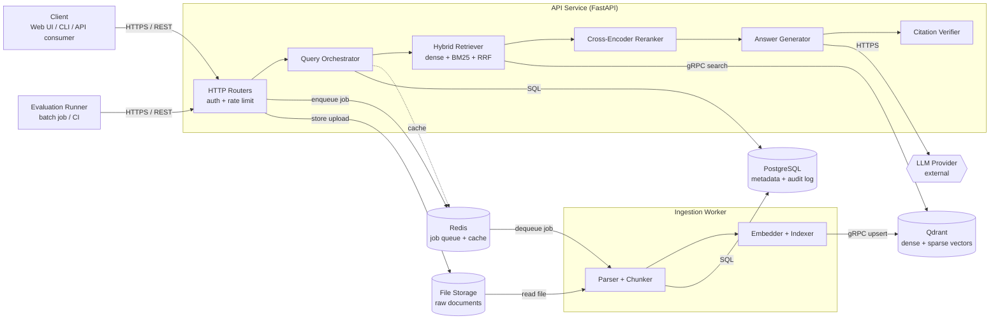
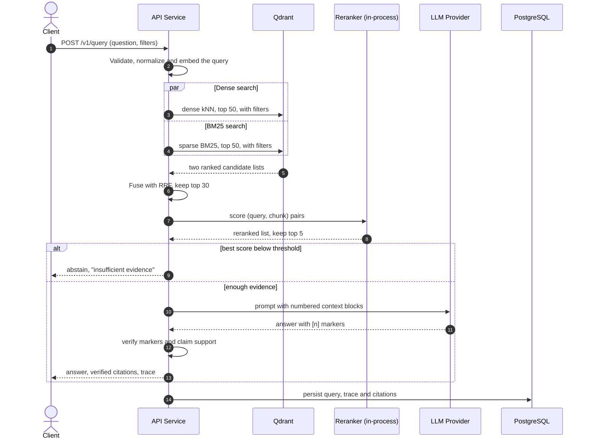
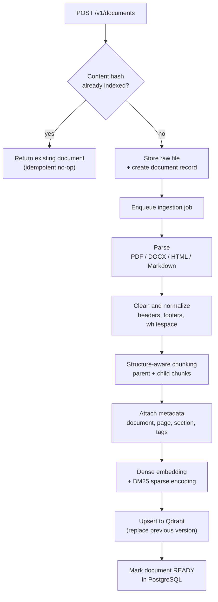
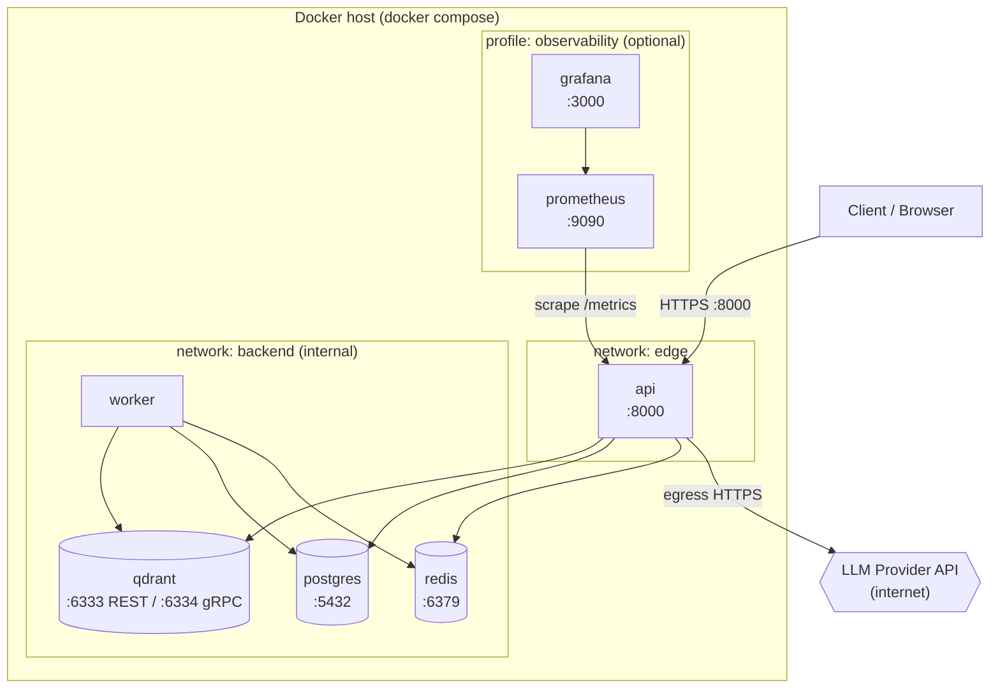
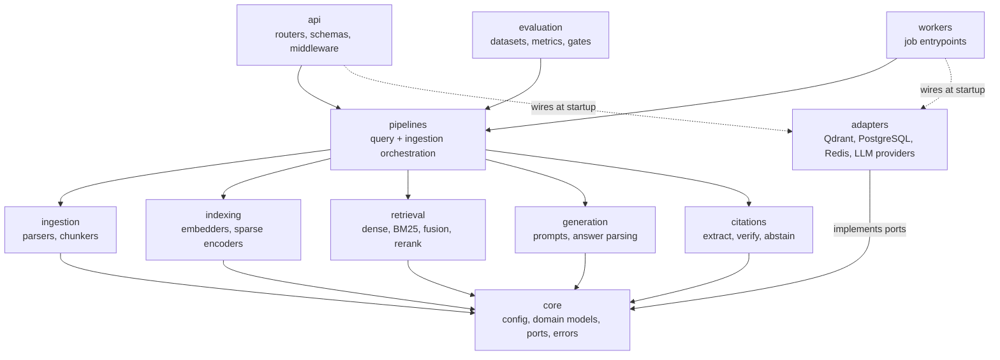

# Hybrid RAG Production Engine

> Production-grade Retrieval-Augmented Generation over internal documents: **hybrid search** (dense vectors + BM25), **cross-encoder reranking**, **verified citations**, and **quantitative evaluation**.


> **Project status: design phase.** This README is the architecture specification for the system. Nothing described here is implemented yet; the [Roadmap](#5-roadmap) tracks what gets built and in which order. Metrics in [Quality Targets](#4-quality-targets) are initial goals, not measured results.

## Table of Contents

1. [Software System](#1-software-system)
   - [1.1 Description](#11-description)
   - [1.2 The Problem](#12-the-problem)
   - [1.3 Key Features](#13-key-features)
   - [1.4 Technology Stack](#14-technology-stack)
   - [1.5 Design Principles](#15-design-principles)
   - [1.6 Reference Dataset: EnterpriseRAG-Bench](#16-reference-dataset-enterpriserag-bench)
2. [Architectural Structure](#2-architectural-structure)
   - [2.1 Component-and-Connector View](#21-component-and-connector-view)
   - [2.2 Deployment Structure](#22-deployment-structure)
   - [2.3 Decomposition Structure](#23-decomposition-structure)
3. [Key Design Decisions](#3-key-design-decisions)
4. [Quality Targets](#4-quality-targets)
5. [Roadmap](#5-roadmap)
6. [Further Reading](#6-further-reading)

---

## 1. Software System

### 1.1 Description

**Hybrid RAG Production Engine** is a Retrieval-Augmented Generation (RAG) backend that answers questions over a company's internal documents. Every answer is grounded in retrieved passages and ships with citations that the system has **verified** against the source text before returning them.

Most RAG demos are a single-PDF chatbot: split the file, embed the chunks, run a nearest-neighbor search, and hand the result to an LLM. That works on a demo and breaks on a real corpus. This project focuses on the parts that decide whether RAG works in production:

- **Retrieval quality**: finding the right passage when users search with exact identifiers, acronyms and paraphrases alike.
- **Grounding**: making sure the answer says only what the sources support, and abstaining when they do not.
- **Measurability**: treating retrieval and answer quality as numbers that are tracked and gated in CI, not impressions.
- **Operability**: ingestion that can be repeated safely, stage-level tracing, health checks and a containerized deployment.

The system is developed and evaluated against a realistic public benchmark, **EnterpriseRAG-Bench**: a simulated company with 511,962 internal documents (Slack, Gmail, Jira, Confluence, Google Drive and more) and 500 evaluation questions whose source documents are known. The **entire corpus is indexed**, so retrieval quality is measured at realistic scale and with realistic noise. See [1.6](#16-reference-dataset-enterpriserag-bench).

### 1.2 The Problem

The failures below are the ones that appear after a RAG demo meets real documents and real users.

| Production failure | Typical cause | How this system addresses it |
|---|---|---|
| The right document exists but is never retrieved | Dense embeddings blur exact terms such as error codes, SKUs, clause numbers and acronyms | **Hybrid retrieval**: dense vectors for meaning plus BM25 for exact terms, merged with Reciprocal Rank Fusion |
| The right chunk is retrieved but ranked 20th and never reaches the LLM | Bi-encoder similarity is a coarse relevance signal | **Cross-encoder reranking** of the fused candidates |
| The answer is split across a chunk boundary, or a chunk lacks context | Fixed-size character splitting ignores document structure | **Structure-aware chunking** with parent-child chunks and section metadata |
| Fluent answers that the documents do not support | Nothing checks the generated text against the sources | **Citation verification** and **abstention** when evidence is weak |
| Fabricated citations (invented page numbers, titles, quotes) | The LLM is asked to write citations itself | The LLM only references numbered context blocks; **citation details are resolved server-side** |
| Quality silently regresses after a model, chunk-size or prompt change | No benchmark, only manual spot checks | **Evaluation harness** with a golden dataset, RAGAS metrics and a CI regression gate |
| Duplicated or stale content after re-uploading documents | Ingestion is not idempotent | **Content-hash based, versioned ingestion** |
| Nobody can explain why an answer was wrong | No visibility into intermediate stages | **Per-stage trace** (candidates, scores, reranking, verification) returned and persisted |

### 1.3 Key Features

**Ingestion**
- Document upload for PDF, DOCX, HTML and Markdown, processed asynchronously by a worker.
- Structure-aware chunking: headings, sections and tables are respected; small **child chunks** are indexed for precision and their larger **parent** passages are used as LLM context.
- Rich metadata per chunk: document, source type (Slack, Jira, Confluence, ...), version, page, section path, tags and access labels.
- Idempotent, versioned ingestion: re-uploading unchanged content is a no-op; changed content replaces the old chunks.
- **Bulk ingestion** of a large dataset corpus (Parquet) with batching, checkpointing and resume, so a 500,000-document load can be interrupted and continued.

**Retrieval**
- **Dense retrieval** (semantic embeddings) and **BM25 retrieval** (sparse lexical vectors) run in parallel.
- **Reciprocal Rank Fusion (RRF)** merges both ranked lists without needing comparable scores.
- **Cross-encoder reranking** reorders the fused candidates with a more accurate relevance model.
- **Metadata filtering** (document, tag, date, access label) applied inside the vector query, not after it.
- Switchable retrieval modes (dense only, BM25 only, hybrid, hybrid + rerank) to enable ablation studies.

**Generation and Citations**
- Provider-agnostic LLM client (Claude Sonnet or GPT-4o).
- Prompts built from numbered context blocks; the LLM answers with `[n]` markers.
- **Citation verification**: every marker must resolve to a retrieved chunk, and every cited claim must be supported by that chunk's text; unsupported claims are removed or flagged.
- **Abstention**: if the best reranked evidence is below a confidence threshold, the system answers that it does not know instead of guessing.
- **Conflict-aware answers**: when retrieved passages disagree or a newer one supersedes an older one (for example an earlier proposed value later replaced by the applied one), the answer prefers the most recent applied information and mentions the earlier value.

**Evaluation**
- Golden dataset of questions with expected source chunks and reference answers.
- Retrieval metrics (Recall@k, MRR, nDCG@k) and generation metrics via **RAGAS** (faithfulness, answer relevancy, context precision, context recall).
- **Benchmark runner** for the full 500-question EnterpriseRAG-Bench set, with a per-category breakdown and metrics aligned with the public leaderboard.
- Ablation report comparing dense-only, BM25-only, hybrid and hybrid + rerank on the same dataset.
- CI gate that fails the build when a metric regresses beyond a tolerance.

**Production readiness**
- Fully containerized with Docker Compose; stateless API that scales horizontally.
- Health endpoints, structured JSON logs and Prometheus metrics.
- API-key authentication and rate limiting.
- Caching for embeddings and repeated queries.

### 1.4 Technology Stack

| Layer | Technology | Reason |
|---|---|---|
| Backend | Python 3.12, FastAPI | Async-first API, typed request/response schemas, automatic OpenAPI docs |
| Vector store | Qdrant | Stores dense and sparse (BM25) vectors in one collection, payload filtering, runs as a server |
| Lexical retrieval | BM25 sparse vectors (stored in Qdrant) | Exact-term matching without maintaining a second search cluster |
| Reranking | Cross-encoder model (for example a BGE reranker) | Much more accurate than similarity search on a short candidate list |
| Embeddings | Configurable (local sentence-transformers model or hosted API) | Swappable without code changes |
| LLM | Claude Sonnet or GPT-4o, behind a provider interface | No vendor lock-in; the model can be compared in evaluation |
| Metadata store | PostgreSQL | Document registry, ingestion jobs, query audit log, evaluation runs |
| Queue and cache | Redis | Background job queue for ingestion and cache for embeddings and answers |
| Dataset loading | PyArrow / Hugging Face `datasets` (Parquet) | Streams the 1.4 GB corpus in batches without loading it into memory |
| Evaluation | RAGAS, custom retrieval metrics and the EnterpriseRAG-Bench harness | Standard generation metrics, exact retrieval measurements and a public, reproducible benchmark |
| Deployment | Docker, Docker Compose | One-command local environment, same images for production |
| Observability | Structured logs, Prometheus metrics (Grafana optional) | Per-stage latency and quality signals |

### 1.5 Design Principles

1. **Measure before tuning.** The evaluation harness is built before chunking, fusion and reranking are tuned; every change is justified by a metric.
2. **Fail closed on evidence.** If the sources do not support an answer, the system abstains. A fluent wrong answer is worse than "I don't know".
3. **Ports and adapters.** Pipeline logic depends on small interfaces (`Embedder`, `VectorStore`, `Reranker`, `LLMClient`); Qdrant, Redis and the LLM providers are adapters behind them.
4. **Every stage is observable and testable alone.** Retrieval, reranking, generation and verification can each be run and evaluated in isolation.
5. **Idempotent by construction.** Ingestion can be retried or repeated without side effects.
6. **Configuration over code.** Models, chunk sizes, `top_k` values, fusion constants and thresholds live in configuration, so experiments do not need code changes.
7. **Test at realistic scale.** Retrieval is developed against the full corpus (511,962 documents), because noise, near-duplicates and search latency do not show up on small corpora.

### 1.6 Reference Dataset: EnterpriseRAG-Bench

The system is built and evaluated on **EnterpriseRAG-Bench** ([repository](https://github.com/onyx-dot-app/EnterpriseRAG-Bench), [dataset](https://huggingface.co/datasets/onyx-dot-app/EnterpriseRAG-Bench), [paper](https://arxiv.org/abs/2605.05253)), an MIT-licensed benchmark released by Onyx in 2026. It simulates a fictional company, **Redwood Inference** (an LLM inference provider), with 511,962 internal documents and 500 questions whose source documents are known. Its generation process adds off-topic threads, half-finished drafts and near-duplicate pages, so retrieval has to ignore realistic clutter.

**The full corpus is indexed, not a subset.** Noise, near-duplicates and search latency only appear at scale, and handling them is the purpose of this project.

**Corpus**

| Source | Documents | Questions that reference it |
|---|---|---|
| Slack | 285,605 | 79 |
| Gmail | 121,390 | 55 |
| Linear | 35,308 | 58 |
| Google Drive | 25,108 | 60 |
| HubSpot | 15,017 | 34 |
| Fireflies (meeting transcripts) | 10,173 | 25 |
| GitHub | 8,052 | 60 |
| Jira | 6,120 | 100 |
| Confluence | 5,189 | 114 |
| **Total** | **511,962** | 500 questions (one question can involve several sources) |

**Questions**

| Category | Questions | What it exercises in this system |
|---|---|---|
| `basic` | 175 | Single-fact lookups, often with exact identifiers (flag names, region codes, pool IDs): hybrid retrieval and BM25 |
| `semantic` | 125 | Descriptive or paraphrased questions: dense retrieval |
| `intra_document_reasoning` | 40 | Reasoning inside one document: chunking and parent-child context |
| `project_related` | 40 | Questions about a project: retrieval across related documents |
| `constrained` | 30 | Detailed questions with many answer facts: context budget and reranking |
| `conflicting_info` | 20 | Sources disagree or one supersedes another: recency and conflict handling |
| `completeness` | 20 | Answers spread over several documents (up to 10): recall at depth |
| `miscellaneous` | 20 | Mixed cases |
| `high_level` | 10 | Broad company questions with no gold documents: synthesis |
| `info_not_found` | 20 | The corpus cannot answer: abstention |

The "what it exercises" column is this project's reading of the category names and sample questions. The authoritative definitions are in the benchmark's `methodology.md`, which is reviewed in Phase 0.

**Ground truth.** Each question has `question_id`, `question_type`, `source_types`, `question`, `expected_doc_ids`, `gold_answer` and `answer_facts`. In the question file, 377 of the 500 questions have exactly one gold document, 30 have none (`high_level` and `info_not_found`), and the most demanding need 10. The 500 questions point to 722 distinct gold documents, about 0.14% of the corpus: a needle-in-a-haystack setting. A separate `extra_questions.jsonl` holds 100 metadata-dependent questions that are excluded from the leaderboard; they are a natural test for metadata filtering.

**Rules and caveats**

- **Usage.** MIT license. The dataset carries a canary GUID and asks that benchmark data stay out of training corpora, so this project uses it only as a retrieval corpus and evaluation set, never for fine-tuning.
- **Synthetic data.** The documents are LLM-generated. Results describe behavior on this benchmark, not on a real company, and every public write-up should say so.
- **Format.** Documents are text records (`doc_id`, `source_type`, `title`, `content`), not files. Ingestion therefore needs a Parquet dataset connector (see [2.1.4](#214-ingestion-runtime-flow)); the PDF, DOCX, HTML and Markdown parsers remain for user uploads.
- **Scale is unmeasured.** Chunk count, token volume, ingestion time and storage are measured by profiling in Phase 2. Until then, sizing is an open question.
- **Leaderboard.** Onyx publishes average correctness for several RAG systems. Scores depend on the generation model and the judge, so this project reports its own models alongside its results and treats comparisons as indicative. A leaderboard entry requires sending a reproduction guide to the maintainers.

---

## 2. Architectural Structure

The architecture is a **modular monolith with a background worker**: one Python codebase produces two runtime services (the API and the ingestion worker) that share domain modules, plus a batch evaluation job. Splitting retrieval, reranking and verification into separate microservices would add network hops and operational cost without a scaling need; the module boundaries (see [2.3](#23-decomposition-structure)) keep that option open.

### 2.1 Component-and-Connector View

This view shows the elements that exist at runtime and how they interact.

The system comprises **one client type, two runtime services (API Service and Ingestion Worker), one batch job (Evaluation Runner), four data stores (Qdrant, PostgreSQL, Redis, file storage) and one external dependency (the LLM provider)**.



#### 2.1.1 Components

1. **Client**
   - Any consumer of the REST API: a web UI, a CLI, or another service.
   - Uploads documents and asks questions. Holds no state about the system.

2. **API Service (FastAPI)**: the stateless request-handling service. It is made of five cooperating components that run in one process:
   - **HTTP Routers**: authentication (API key), rate limiting, request validation, and the endpoints for documents, queries and health.
   - **Query Orchestrator**: runs the query pipeline stage by stage, applies the abstention policy, records the trace and writes the audit log.
   - **Hybrid Retriever**: embeds the query, runs the dense search and the BM25 search in parallel with the same metadata filters, and merges the lists with RRF.
   - **Cross-Encoder Reranker**: scores `(query, chunk)` pairs for the fused candidates and keeps the best few.
   - **Answer Generator**: builds the prompt from numbered context blocks and calls the LLM through the provider interface.
   - **Citation Verifier**: checks that the answer's citation markers are valid and that the cited claims are supported by the cited chunks.

3. **Ingestion Worker**
   - Consumes ingestion jobs from the queue; same codebase and image as the API, different entrypoint.
   - **Parser + Chunker** turns a raw file into structured, metadata-rich chunks. **Embedder + Indexer** computes dense and sparse vectors and upserts them to Qdrant.
   - Scales independently of the API, by queue depth.
   - Also performs **bulk loading** of the reference corpus: the same pipeline, fed by a Parquet dataset connector instead of an uploaded file (see 2.1.4).

4. **Evaluation Runner**
   - Batch job (local command or CI step) that runs the golden dataset through the pipeline, computes retrieval and RAGAS metrics, compares them with the stored baseline, and fails when a metric regresses.

5. **Qdrant (vector database)**
   - Holds one collection with a **dense vector** and a **sparse (BM25) vector** per chunk, plus a payload with the metadata used for filtering and citations.
   - Sized for the full reference corpus (at least 511,962 points, more if long documents are split): on-disk vector storage and quantization keep memory bounded. Exact sizing is measured in Phase 2.

6. **PostgreSQL (metadata store)**
   - Document registry (id, version, content hash, status), ingestion jobs, query and answer audit log with traces, and evaluation run results.

7. **Redis (queue and cache)**
   - Job queue between the API and the worker, plus a cache for query embeddings and repeated answers.

8. **File Storage**
   - Keeps the original uploaded documents so they can be re-parsed when the chunking strategy changes. A Docker volume in the reference deployment; object storage (S3-compatible) in production.

9. **LLM Provider (external)**
   - Claude Sonnet or GPT-4o. The only component outside the deployment boundary; reached through the `LLMClient` interface.

#### 2.1.2 Connectors

| # | Connector | Type | From | To | Description |
|---|---|---|---|---|---|
| K1 | REST over HTTPS | Request/response | Client | HTTP Routers | Upload documents, ask questions, read document status. JSON payloads, API-key header |
| K2 | REST over HTTPS | Request/response | Evaluation Runner | HTTP Routers | Replays the golden dataset against the deployed API |
| K3 | In-process calls | Procedure call | Routers, Orchestrator, Retriever, Reranker, Generator, Verifier | the next stage | Synchronous pipeline inside the API process; each stage has a typed input and output |
| K4 | Job enqueue | Asynchronous messaging (producer) | HTTP Routers | Redis | Publishes an ingestion job after an upload is stored |
| K5 | Job dequeue | Asynchronous messaging (consumer, pull) | Ingestion Worker | Redis | Worker pulls jobs, with retries and a dead-letter list for failures |
| K6 | Vector search | Data access (client-server, gRPC) | Hybrid Retriever | Qdrant | Dense kNN and sparse BM25 queries with payload filters |
| K7 | Vector upsert | Data access (client-server, gRPC) | Ingestion Worker | Qdrant | Batched upsert and delete of chunks for a document version |
| K8 | SQL | Data access (client-server, TCP) | API Service, Ingestion Worker | PostgreSQL | Document registry, job status, audit log, evaluation results |
| K9 | LLM call | Request/response (HTTPS) | Answer Generator | LLM Provider | Prompt with numbered context blocks; the response contains the answer and `[n]` markers |
| K10 | File storage | Shared data (volume or object store) | HTTP Routers (write), Ingestion Worker (read) | File Storage | Raw uploaded documents, and the downloaded dataset files read by bulk ingestion |
| K11 | Cache access | Data access (client-server, TCP) | Query Orchestrator | Redis | Query embedding and answer cache |
| K12 | Metrics scrape | Pull (HTTP) | Prometheus (optional) | API Service `/metrics` | Per-stage latency, retrieval counts, abstention rate |

#### 2.1.3 Query Runtime Flow



The `top_k` values (50, 30, 5) are starting points and live in configuration; they are tuned using the evaluation harness.

**Citation contract.** The LLM never writes document names, page numbers or quotes. It only emits markers such as `[2]`. The API resolves each marker to the chunk that was placed in the prompt and returns the source details itself:

```json
{
  "answer": "Refunds for annual plans are available within 30 days of purchase [1].",
  "abstained": false,
  "citations": [
    {
      "marker": 1,
      "document": "billing-policy-v3.pdf",
      "page": 4,
      "section": "Refunds > Annual plans",
      "quote": "Annual subscriptions may be refunded within 30 days of purchase.",
      "verified": true
    }
  ],
  "trace": {
    "mode": "hybrid+rerank",
    "dense_candidates": 50,
    "sparse_candidates": 50,
    "fused_candidates": 30,
    "reranked_used": 5,
    "latency_ms": { "retrieval": 180, "rerank": 95, "generation": 1400, "verification": 210 }
  }
}
```

The values above are an illustrative example of the response shape, not measurements.

#### 2.1.4 Ingestion Runtime Flow



If any step fails, the job is retried with backoff and the document status becomes `FAILED` with the error recorded; a document is never left half-indexed because the new chunks replace the previous version only after the upsert succeeds.


**Bulk ingestion of the reference corpus.** The EnterpriseRAG-Bench corpus (about 1.4 GB of Parquet) goes through the same pipeline, fed by a dataset connector instead of an upload:

1. Stream the Parquet files in batches; the corpus is never loaded into memory at once.
2. Chunk each document with a strategy chosen by source type. Short conversational documents (Slack, Gmail) are likely to be indexed as a single chunk, while long documents (Confluence, Google Drive, meeting transcripts) are split along their structure. The strategy is validated against the length profile measured in Phase 2.
3. Embed and upsert in batches, using deterministic point IDs derived from `doc_id` and the chunk index, so a repeated batch overwrites instead of duplicating.
4. Record a checkpoint (last completed batch per source file) in PostgreSQL, so an interrupted run resumes instead of restarting.
5. Expose progress and throughput as metrics: documents per second, embedding queue depth and failed batches.

### 2.2 Deployment Structure

The reference deployment follows a **container orchestration pattern with Docker Compose**: each runtime service is a container, stateful services use named volumes, and a network split keeps the data stores unreachable from outside.



The `api` container is attached to both networks: it is the only service reachable from outside, and the only one (besides `worker`) that can reach the data stores. Data stores publish no ports to the host in the default configuration.

#### 2.2.1 Deployment Units

| Unit | Image | Depends on | Health check | Persistent volume |
|---|---|---|---|---|
| `api` | Built from the project `Dockerfile` (multi-stage, non-root user) | `qdrant`, `postgres`, `redis` (healthy) | `GET /health/ready` (checks the three dependencies) | `uploads`, `model_cache` |
| `worker` | Same image as `api`, different command | `qdrant`, `postgres`, `redis` (healthy) | Redis heartbeat key refreshed by the worker loop | `uploads`, `model_cache`, `data` (dataset, read-only) |
| `qdrant` | Official `qdrant/qdrant` image | none | HTTP readiness endpoint | `qdrant_storage` |
| `postgres` | Official `postgres` image (alpine variant) | none | `pg_isready` | `pg_data` |
| `redis` | Official `redis` image (alpine variant) | none | `redis-cli ping` | `redis_data` |
| `prometheus` (optional) | Official `prom/prometheus` image | `api` | HTTP `/-/healthy` | `prometheus_data` |
| `grafana` (optional) | Official `grafana/grafana` image | `prometheus` | HTTP `/api/health` | `grafana_data` |

Image tags are pinned to exact versions when the Compose file is written.

#### 2.2.2 Services Configuration

| Service | External port | Internal port | Network | Description |
|---|---|---|---|---|
| `api` | 8000 | 8000 | `edge`, `backend` | REST API, OpenAPI docs at `/docs`, metrics at `/metrics` |
| `worker` | none | none | `backend` | Background ingestion jobs |
| `qdrant` | none (6333 optional for local debugging) | 6333 REST, 6334 gRPC | `backend` | Vector and BM25 index |
| `postgres` | none | 5432 | `backend` | Metadata and audit log |
| `redis` | none | 6379 | `backend` | Queue and cache |
| `prometheus` | 9090 | 9090 | `backend` | Metrics (profile `observability`) |
| `grafana` | 3000 | 3000 | `backend` | Dashboards (profile `observability`) |

#### 2.2.3 Configuration

All configuration comes from environment variables documented in `.env.example`; secrets are never baked into images. The main groups:

- **Providers**: `LLM_PROVIDER`, `LLM_MODEL`, `ANTHROPIC_API_KEY` / `OPENAI_API_KEY`, `EMBEDDING_MODEL`, `RERANKER_MODEL`.
- **Retrieval**: `DENSE_TOP_K`, `SPARSE_TOP_K`, `FUSION_TOP_K`, `RERANK_TOP_K`, `RRF_K`, `ABSTAIN_THRESHOLD`.
- **Infrastructure**: `QDRANT_URL`, `DATABASE_URL`, `REDIS_URL`, `UPLOAD_DIR`, `DATASET_DIR`.
- **Security**: `API_KEYS`, `RATE_LIMIT_PER_MINUTE`.

#### 2.2.4 Infrastructure Notes

- **Network segmentation**: only `api` is reachable from outside; the data stores live on an `internal` network with no route to the internet.
- **Scaling**: `api` is stateless and scales horizontally behind a load balancer; `worker` scales with queue depth; Qdrant starts as a single node, with sharding and replication available when the corpus requires it.
- **Compute**: the reranker is CPU-bound by default and can use a GPU if latency requires it. If model weight becomes a problem, embedding and reranking can be extracted into their own inference service, because they already sit behind interfaces.
- **Reference corpus sizing**: indexing 511,962 documents makes embedding the dominant ingestion cost and the vector index the dominant memory cost. Embedding throughput, Qdrant memory and disk, and total ingestion time are measured in Phase 2 and recorded in this section; until then they are unknown. Levers if needed: on-disk vectors, scalar quantization, HNSW tuning, a smaller embedding model, and a GPU or hosted embedding API for the bulk load. The dataset directory (`data/`) is a git-ignored volume and is never committed.
- **Production path**: the same images run on Kubernetes or a managed container service; the file volume becomes object storage and PostgreSQL/Redis become managed services.
- **Access control**: document-level access labels are stored in the chunk payload and applied as filters inside the vector query.

### 2.3 Decomposition Structure

The decomposition view shows how the code is divided into modules and which modules may use which. The rule is **dependencies point downward**: interface-defining modules (`core`) sit at the bottom, and nothing in the domain modules imports an infrastructure library directly.



`observability` (logging, tracing, metrics) is a cross-cutting module used by every layer and is omitted from the diagram to keep it readable.

**Planned repository layout**

```text
hybrid-rag-production-engine/
├── README.md
├── pyproject.toml
├── Dockerfile
├── docker-compose.yml
├── .env.example
├── docs/
│   └── rag-primer.html          # What is RAG: a short guide
├── src/rag_engine/
│   ├── api/                     # FastAPI routers, request/response schemas, auth, rate limiting
│   ├── workers/                 # Ingestion worker entrypoint and job handlers
│   ├── pipelines/               # Query pipeline and ingestion pipeline orchestration
│   ├── ingestion/               # Dataset connectors (Parquet), file parsers, cleaners, chunkers
│   ├── indexing/                # Dense embedders, BM25 sparse encoder
│   ├── retrieval/               # Dense and sparse retrievers, RRF fusion, reranker, filters
│   ├── generation/              # Prompt builder, answer parser
│   ├── citations/               # Marker extraction, verification, abstention policy
│   ├── adapters/                # Qdrant, PostgreSQL, Redis, Claude and OpenAI clients
│   ├── evaluation/              # Golden dataset, retrieval metrics, RAGAS runner, EnterpriseRAG-Bench runner, regression gate
│   ├── observability/           # Structured logging, tracing, Prometheus metrics
│   └── core/                    # Settings, domain models, ports (interfaces), exceptions
├── data/                        # Downloaded benchmark corpus (git-ignored, never committed)
├── scripts/                     # Dataset download and maintenance utilities
├── eval/
│   ├── datasets/                # Golden questions and reference answers
│   └── reports/                 # Ablation and regression reports
└── tests/
    ├── unit/
    ├── integration/             # Against real Qdrant, PostgreSQL and Redis containers
    └── e2e/
```

#### 2.3.1 Module Descriptions

- **`api`**: the HTTP boundary. Defines routes, Pydantic schemas, API-key authentication, rate limiting and error mapping. Contains no business logic; it validates input and calls a pipeline.
- **`workers`**: process entrypoint for background jobs. Pulls jobs from the queue and invokes the ingestion pipeline with retry and dead-letter handling.
- **`pipelines`**: the two orchestrations: the **ingestion pipeline** (parse, chunk, encode, index) and the **query pipeline** (retrieve, fuse, rerank, abstain-or-generate, verify). Owns stage ordering, timing and trace collection.
- **`ingestion`**: converts raw files and dataset records into clean, structured chunks. Dataset connectors (Parquet), parsers per file format, text cleaning, and the chunking strategies (recursive, structure-aware, parent-child, selected per source type).
- **`indexing`**: produces the vectors: dense embedders behind an `Embedder` interface and the BM25 sparse encoder behind a `SparseEncoder` interface.
- **`retrieval`**: finds and ranks candidates: dense retriever, BM25 retriever, Reciprocal Rank Fusion, metadata filter builder, and the cross-encoder reranker behind a `Reranker` interface.
- **`generation`**: builds prompts from numbered context blocks and parses LLM output into an answer and a list of markers. Provider calls go through the `LLMClient` port.
- **`citations`**: the grounding layer: extracts markers, resolves them to chunks, verifies claim support (entailment or LLM-as-judge, configurable), and applies the abstention policy.
- **`adapters`**: the only modules that import infrastructure libraries. Implement the ports from `core` for Qdrant, PostgreSQL, Redis and the LLM providers. Replacing a vector store or LLM vendor means writing a new adapter.
- **`evaluation`**: dataset loading, retrieval metrics, RAGAS integration, the EnterpriseRAG-Bench runner (per-category results), ablation runner and the CI regression gate.
- **`observability`**: structured logging with request IDs, per-stage timing, and Prometheus metrics, used by all modules.
- **`core`**: settings, domain models (`Document`, `Chunk`, `Citation`, `Answer`, `Trace`), the port interfaces (`VectorStore`, `Embedder`, `Reranker`, `LLMClient`, `JobQueue`), and the exception hierarchy. Depends on nothing else in the project.

#### 2.3.2 Functionalities Description

- **Document management**
  - `POST /v1/documents`: upload a document (returns the document record and job status).
  - `GET /v1/documents` and `GET /v1/documents/{id}`: list documents and read ingestion status.
  - `DELETE /v1/documents/{id}`: remove a document and all of its chunks.
- **Question answering**
  - `POST /v1/query`: ask a question with optional filters; options select the retrieval mode (dense, sparse or hybrid) and whether reranking is applied.
  - Returns the answer, the verified citations, an `abstained` flag and the per-stage trace.
- **Bulk ingestion** (CLI, not exposed over HTTP)
  - Load the downloaded benchmark corpus into the index in batches, with checkpoint and resume.
- **Evaluation** (CLI and CI, not exposed over HTTP)
  - Run the golden dataset and the 500 EnterpriseRAG-Bench questions, compute retrieval and RAGAS metrics, report results per question category, produce the ablation report, compare with the baseline and fail on regression.
- **Operations**
  - `GET /health/live` and `GET /health/ready`: liveness and dependency-aware readiness.
  - `GET /metrics`: Prometheus metrics.

---

## 3. Key Design Decisions

| Decision | Choice | Rationale | Alternatives considered |
|---|---|---|---|
| Where BM25 lives | Sparse vectors in Qdrant, next to the dense vectors | One write path and one filter system, so the dense and lexical indexes cannot drift apart | ChromaDB plus an in-memory BM25 library (not persistent or safe across processes); a separate Elasticsearch/OpenSearch cluster (extra infrastructure) |
| Where fusion happens | In the application | Works with any vector store, is unit-testable and its parameters are tunable and visible in the trace | Qdrant server-side fusion (less transparent, ties the logic to one vendor) |
| How results are merged | Reciprocal Rank Fusion | BM25 scores and cosine similarities are not comparable; RRF uses ranks only and needs no score calibration | Weighted score sum (needs normalization and per-corpus tuning) |
| Reranking | Cross-encoder over a bounded candidate list | Best accuracy gain for the cost; latency is bounded by the number of candidates | No reranking (cheaper, lower precision); LLM-based reranking (slower and costlier) |
| Citations | LLM emits markers; server resolves details | The model cannot invent page numbers or quotes | LLM writes full citations (hallucination risk) |
| Weak evidence | Abstain | Protects trust in the answers | Always answer (higher coverage, unsupported answers) |
| Service topology | Modular monolith with a worker | One codebase and one image, simple to operate | Microservices per stage (premature at this scale) |
| Vendors | Behind ports and adapters | LLM, embedding and store can be compared in evaluation and replaced | Direct SDK calls throughout the code |
| Tuning workflow | Evaluation harness first | Every retrieval change is backed by a metric | Manual spot checks |
| Corpus scale | Index the full EnterpriseRAG-Bench corpus (511,962 documents) | Noise, near-duplicates and search latency appear only at realistic scale, and handling them is the point of the project | A subset (faster to iterate, but hides the production problems) |
| Evaluation target | EnterpriseRAG-Bench plus a smaller custom golden set | A public, reproducible benchmark with known source documents and public baselines; the custom set covers system-specific stages | A self-made dataset only (not comparable with anything); the Kaggle datasets reviewed (small or simulated) |

---

## 4. Quality Targets

Initial goals, to be revised after the first measured baseline.

| Attribute | Metric | Initial target |
|---|---|---|
| Retrieval quality | Document recall@10 against `expected_doc_ids`, full corpus indexed | Hybrid + rerank beats dense-only by a measurable margin; absolute target set after baseline |
| Answer grounding | RAGAS faithfulness | at least 0.90 |
| Citation validity | Returned citations that resolve to a retrieved chunk | 100% (enforced by the verifier, not just measured) |
| Honesty | Correct abstention on the 20 `info_not_found` questions | Tracked per category |
| Benchmark standing | Average correctness across the 10 categories (500 questions) | First milestone: above the LangChain and LlamaIndex entries on the public leaderboard; stretch goal: above RAGFlow. Scores depend on the generation and judge models, so they are reported together |
| Retrieval latency | p95 of retrieve + fuse + rerank, excluding the LLM | under 1 second with the full corpus indexed |
| Ingestion safety | Duplicate chunks after re-uploading an unchanged document | 0 |
| Regression safety | CI fails when a tracked metric drops beyond tolerance | Enabled from Phase 4 |

---

## 5. Roadmap

| Phase | Goal | Main deliverables | Status |
|---|---|---|---|
| 0 | Design and documentation | Architecture README, RAG primer, dataset selection, review of the benchmark's `methodology.md` | In progress |
| 1 | Project skeleton | FastAPI app, settings, Docker Compose with Qdrant, PostgreSQL and Redis, health endpoints, lint and test CI | Planned |
| 2 | Ingestion at scale | Parquet dataset connector, dataset profiling (document lengths, chunk counts), source-aware chunking, embeddings, dense and BM25 indexing, idempotent bulk load of the full corpus with checkpoint and resume, sizing report | Planned |
| 3 | Hybrid retrieval | Dense and BM25 retrievers, RRF fusion, metadata filters, retrieval modes | Planned |
| 4 | Evaluation harness and reranking | EnterpriseRAG-Bench runner with per-category results, retrieval metrics, cross-encoder reranker, first ablation report, CI regression gate | Planned |
| 5 | Grounded generation | Prompting, LLM adapters, citation verification, abstention policy, conflict-aware answering, RAGAS metrics | Planned |
| 6 | Production hardening | Auth, rate limiting, caching, tracing, Prometheus and Grafana, load test | Planned |
| 7 | Results and write-up | Full benchmark results and ablation study, leaderboard submission with a reproduction guide, demo UI, lessons learned | Planned |

---

## 6. Further Reading

- [`docs/rag-primer.html`](docs/rag-primer.html): a short, concise guide to what RAG is, how it works and what matters when building it. Download the repository or open the file locally in a browser to view it.
- EnterpriseRAG-Bench: [repository](https://github.com/onyx-dot-app/EnterpriseRAG-Bench), [dataset](https://huggingface.co/datasets/onyx-dot-app/EnterpriseRAG-Bench), [leaderboard](https://huggingface.co/spaces/onyx-dot-app/EnterpriseRAG-Bench-Leaderboard) and [paper](https://arxiv.org/abs/2605.05253).
